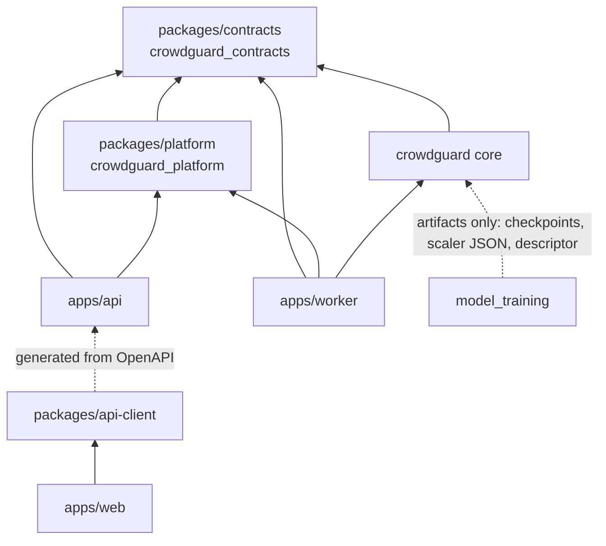

# Monorepo structure

**Status:** [Proposed] target layout, revision 1 (2026-11-26). Nothing below `apps/`, `packages/`, `infra/`, or `tests/` exists yet. [PROJECT_STRUCTURE.md](../../PROJECT_STRUCTURE.md) describes the **current** layout and should be updated (in a task that allows it) once Task 0.3 lands.

## 1. Principles

- **Additive first.** New components go under `apps/`, `packages/`, `infra/`, and `tests/`. Existing paths stay where they are, because the Streamlit app, the CLI, README commands, and training scripts depend on them:
  - `crowdguard/`
  - `model_training/`
  - `app.py`
  - `config/`
  - `data/`
  - `outputs/`
  - `requirements.txt`
- **One deployable per `apps/*` directory, one reusable library per `packages/*` directory.** Each Python unit has its own `pyproject.toml` and a **unique import name**. No package is named `app`, because it would collide with the root `app.py`.
- **Dependencies point one way** (§3). The API stays free of torch and OpenCV; only the worker loads models.
- **Research is separate.** `model_training/` is not a workspace member, and product code never imports it.
- Any later move of existing directories is a separately reviewed migration (§6), never a side effect of a feature task.

## 2. Target layout

```text
Crowd_Guard_AI/
├── CLAUDE.md, README.md, PROJECT_STRUCTURE.md   [current] docs entry points
├── pyproject.toml          [new, Task 0.3] uv workspace root; also the `crowdguard` core project; import-linter + pytest config
├── uv.lock                 [new] Python lockfile (D-19)
├── package.json            [new] pnpm workspace root scripts only
├── pnpm-workspace.yaml     [new] apps/web, packages/api-client
├── pnpm-lock.yaml          [new]
├── .claude/rules/          [current] path-scoped Claude Code rules
│
├── apps/                   deployables
│   ├── api/                FastAPI service → import `crowdguard_api`
│   │   ├── pyproject.toml
│   │   ├── crowdguard_api/
│   │   │   ├── main.py         app factory, router wiring
│   │   │   ├── auth.py         principal dependency (trusted single operator in MVP)
│   │   │   ├── routers/        uploads.py, analyses.py, zone_configs.py
│   │   │   └── services/       uploads.py, analyses.py, retention.py, sweeper.py
│   │   └── tests/
│   ├── worker/             job runner → import `crowdguard_worker`
│   │   ├── pyproject.toml
│   │   ├── crowdguard_worker/  runner.py, validate_upload.py, analyze.py, artifacts.py, probe.py
│   │   └── tests/
│   └── web/                React + Vite + TypeScript
│       ├── package.json, vite.config.ts, tsconfig.json
│       └── src/            features/{upload,zones,analysis,results}/, lib/, components/
│
├── packages/               shared libraries
│   ├── contracts/          → `crowdguard_contracts`: pydantic models + enums + error catalog (no heavy deps)
│   │   ├── pyproject.toml, crowdguard_contracts/, tests/
│   ├── platform/           → `crowdguard_platform`: settings, SQLite db + migrations, repositories, ObjectStore (S3), audit
│   │   ├── pyproject.toml, crowdguard_platform/, tests/
│   └── api-client/         TypeScript types + fetch client generated from the API's OpenAPI schema
│
├── crowdguard/             [current, stays] core vision/model library + CLI
│   ├── main.py             [current] CLI, becomes a thin adapter in Task 2 (flags/outputs unchanged)
│   ├── processing.py, feature_schema.py, overlay.py      [new]
│   ├── models/             [new] adapters, registry, orchestrator, ucsd/ (Phase 2)
│   └── risk/               [new] decision policy, rule signals, policies/*.yaml
│
├── model_training/         [current, stays] research: UCSD GRU/LSTM experiments, own requirements.txt
├── app.py                  [current, frozen] Streamlit prototype
├── config/                 [current] example zones (demo capacities)
├── infra/s3/               [new, Task 10] bucket policy, CORS, lifecycle, IAM templates (placeholders only)
├── tests/
│   ├── core/               [new] tests for crowdguard/ core
│   ├── e2e/                [new] Playwright cross-app suite + harness
│   └── fixtures/           [new] generators only (no committed media or weights)
├── docs/                   [current] architecture/, testing/, superpowers/plans/, prompts/
└── data/, outputs/, var/   git-ignored runtime data (var/ holds the SQLite DB and local temp)
```

## 3. Dependency rules



| Unit | May depend on | Must not depend on |
|---|---|---|
| `crowdguard_contracts` | stdlib, pydantic | anything else in the repo |
| `crowdguard_platform` | contracts, boto3, sqlite3 | `crowdguard` core, FastAPI, torch, OpenCV |
| `crowdguard` core | contracts, OpenCV, Ultralytics, numpy, torch | platform, apps, FastAPI, boto3, `model_training`, `app.py` |
| `crowdguard_api` | contracts, platform, FastAPI | `crowdguard` core (keeps the API image light), worker |
| `crowdguard_worker` | contracts, platform, `crowdguard` core | api |
| `apps/web` | `packages/api-client` | Python code; direct S3 SDK credentials |
| `model_training` | its own requirements | any product package (one-way: it publishes artifacts) |

The UCSD adapter (Task 11) **ports** the GRU/LSTM architecture class into `crowdguard/models/ucsd/` and tests parity by loading the same `state_dict`. It does not import `model_training/src` (which manipulates `sys.path`).

Enforcement is part of Task 0.3: import-linter contracts in the root `pyproject.toml`, run in CI, plus a test that `crowdguard_api` imports without torch or cv2 installed.

## 4. Tooling (decision D-19)

Recommended: **uv workspaces** for Python and **pnpm workspaces** for TypeScript. Both are new tools, so get approval before adding them. Until approval, Task 0.3 may fall back to `pip install -e` per package with per-unit requirements files. The existing `requirements.txt` stays valid for the Streamlit and CLI path either way.

| Concern | Convention |
|---|---|
| Python version | 3.11 (README recommends 3.10/3.11) |
| Lint and format | ruff (root config) |
| Python tests | `pytest` per unit: `packages/*/tests`, `apps/*/tests`, `tests/core`. Root `pytest` config does not collect `model_training/tests` unless asked |
| TS tests | vitest in `apps/web`; Playwright in `tests/e2e` |
| OpenAPI → TS | A generation script in `packages/api-client`. The generated output is committed so that review shows contract changes |
| CI | Path-filtered jobs per unit, plus an always-on contracts and import-boundary job |

## 5. Ownership and agent scope

| Path | Changes require |
|---|---|
| `packages/contracts/**`, `packages/api-client/**` (generated), `docs/architecture/**` | A contract task, serial with every other task (see plan "Agent boundaries") |
| `packages/platform/**` | Its plan task. Schema migrations are append-only SQL files |
| `apps/api/**`, `apps/worker/**`, `apps/web/**` | Their plan tasks only |
| `crowdguard/**` | Core tasks. `main.py` CLI behavior is frozen by the Task 2 golden test |
| `model_training/**`, `app.py`, `config/**` | Explicit approval. Frozen during Phase 1 |
| Root `pyproject.toml`, workspace and lock files, `.gitignore`, CI | Task 0.3 or an explicitly assigned tooling task |

## 6. Deferred migration (not scheduled)

After Phase 1 is accepted, a reviewed migration **may** move `crowdguard/` to `packages/core/` and `model_training/` to `ml/training/`, and retire `app.py`. That migration must:

- update README commands, rules, and docs in the same change;
- keep a compatibility shim or document the command change;
- pass the CLI golden test and the full E2E suite;
- be done by one agent, with no parallel tasks.

Until then, those paths stay put.
