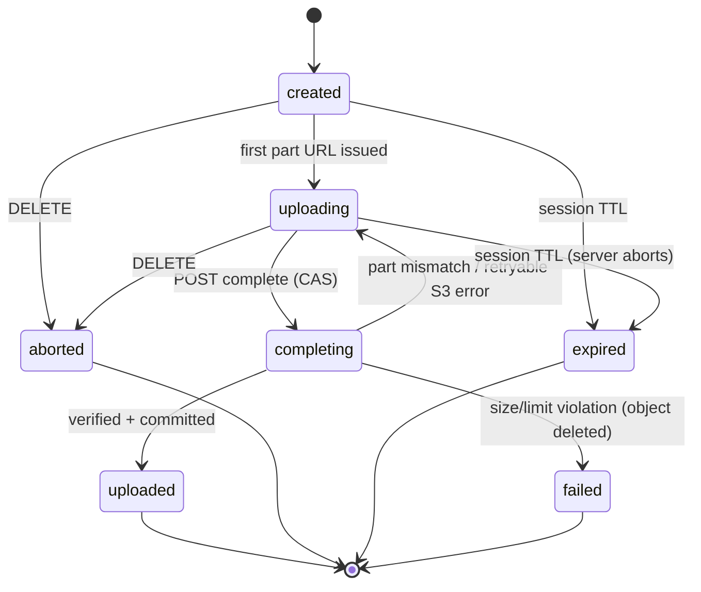

# S3 direct-upload design

**Status:** [Proposed] Accepted direction for the MVP. Nothing here is implemented yet. Parent: [system-architecture.md](system-architecture.md).

## 1. Decision

Video bytes go **directly from the browser to a private S3 bucket** through short-lived presigned URLs. FastAPI never receives video bytes. FastAPI owns:

- upload-session creation, authorization, quotas, and limits;
- the generated object key and the real S3 multipart `UploadId` (both server-side only);
- issuing presigned URLs for specific parts;
- verifying and completing the upload, idempotently;
- creating the analysis job **only after** S3 verification and a media probe.

Why: large videos would tie up API workers and memory, and direct upload adds part-level retry and resume. The cost is more client logic and S3 configuration, which this document specifies.

## 2. AWS facts this design relies on

Verify each item against current AWS documentation in plan Task 0.2 (spike) before implementation. Treat it as a checklist, not a source.

| Fact | Used for |
|---|---|
| Multipart part numbers are 1–10,000. Each part must be at least 5 MiB except the last, and at most 5 GiB. | Part-size and count validation. 16 MiB × 10,000 parts bounds the file at about 156 GiB, far above the product limit. |
| Parts can be uploaded in parallel and retried independently; re-uploading the same part number replaces it. | Concurrency and retry. |
| `ListParts` returns the parts S3 holds (paginated). | Server-side truth for resume and completion. |
| `CompleteMultipartUpload` can return HTTP 200 with an error in the body, and a repeat call after success fails with `NoSuchUpload`. | Completion error handling and idempotency. |
| Uncompleted multipart uploads keep their parts stored (and billed) until completed or aborted. A part upload in progress during an abort may still succeed. | Abort plus a confirmatory `ListParts`, and a lifecycle rule. |
| A lifecycle rule `AbortIncompleteMultipartUpload` with `DaysAfterInitiation` can clean up abandoned uploads. | Cleanup. |
| S3 supports per-part additional checksums (CRC32, CRC32C, SHA-1, SHA-256, CRC64NVME) chosen at `CreateMultipartUpload`, and rejects a part whose checksum header does not match its bytes. | Integrity verification. |
| The browser can read `ETag` from a cross-origin PUT response only if CORS `ExposeHeaders` includes `ETag`. | CORS config. |
| A presigned URL acts with the signer's permissions, and expires at the earlier of its `X-Amz-Expires` and the signing credentials' expiry. | IAM scope and renewal. |

Spike questions (Task 0.2): how to presign `UploadPart` so the browser's `x-amz-checksum-sha256` header is required and signed; which checksum type (composite or full-object) fits SHA-256 for multipart; how `HeadObject` with `ChecksumMode=ENABLED` reports multipart checksums; and whether the chosen S3-compatible test endpoint (MinIO or moto server) behaves the same for checksums and CORS. Record the answers in this document before Task 5.

## 3. Strategy and defaults (all configurable)

| Setting | Default | Notes |
|---|---|---|
| `UPLOAD_MULTIPART_THRESHOLD_BYTES` | 100 MiB | Below: one presigned `PutObject`. At or above: multipart. |
| `UPLOAD_PART_SIZE_BYTES` | 16 MiB | Must be at least 5 MiB. Fixed per session and returned to the client. |
| `UPLOAD_MAX_CONCURRENT_PARTS` | 3 | Client-side limit, returned in the session. |
| `UPLOAD_PART_URL_TTL_S` | 900 | Short. The client requests a new URL on expiry. |
| `UPLOAD_SESSION_TTL_S` | 24 h | The session expires after this; then abort. |
| `UPLOAD_MAX_BYTES` | open decision D-12 | Validated against the declared size at create **and** the actual size at complete. |
| `UPLOAD_MAX_DURATION_S` | open decision D-12 | Validated by the probe. |
| `UPLOAD_ALLOWED_CONTAINERS` | MP4, MOV, AVI (from the current README); open decision D-12 | Enforced by the probe, not by extension. |
| Checksum algorithm | SHA-256 per part (WebCrypto `crypto.subtle.digest`) | Pending the spike. CRC32C needs a JS library. |
| Part retries | 4 attempts, exponential backoff with jitter | Retry only the failed part. |
| Lifecycle abort-incomplete | 1 day | Must be at least `UPLOAD_SESSION_TTL_S`. |

Part count = `ceil(size / part_size)` and must be ≤ 10,000. Otherwise the session is rejected (`UPLOAD_TOO_MANY_PARTS`).

## 4. API contract

All bodies are JSON. Responses never include the S3 key, the bucket name, or the S3 `UploadId`. `upload_id` is an opaque application ID.

### `POST /api/v1/uploads`

Request: `{"display_name": "event.mp4", "size_bytes": 734003200, "content_type": "video/mp4"}`.

The server checks the owner's quota (active sessions, bytes per day, active analyses) and the rate limit, that the declared size is ≤ max, and that the declared type is in the allow-list (a hint only). It then creates the `analysis` (`awaiting_upload`) and the `upload_session` (`created`), with key `uploads/{analysis_id}/source`. For multipart it calls `CreateMultipartUpload` with the checksum algorithm, SSE settings, and a fixed server-chosen `Content-Type`, and stores the real `UploadId` server-side.

Response `201`:

```json
{"upload_id": "up_…", "analysis_id": "an_…", "strategy": "multipart",
 "part_size": 16777216, "part_count": 44, "max_concurrency": 3,
 "checksum_algorithm": "SHA256", "expires_at": "2026-11-27T10:00:00Z"}
```

### `POST /api/v1/uploads/{upload_id}/part-urls`

Request: `{"parts": [{"part_number": 1, "size_bytes": 16777216, "checksum_sha256": "<base64>"}]}`, at most N parts per request.

The server checks ownership, that the state is `created` or `uploading`, that `1 ≤ part_number ≤ part_count`, that the size equals `part_size` (or the expected remainder for the last part), and the checksum format. It returns `[{part_number, url, expires_at, required_headers}]`. For `strategy = single` it accepts `part_number = 1` only and returns a presigned `PutObject` URL. The first call moves the session to `uploading`.

### `GET /api/v1/uploads/{upload_id}`

Returns the state and **server-verified** parts from `ListParts` (`[{part_number, size_bytes, etag, checksum}]`). The client uses this to resume after a reload or network loss and does not trust its local record over S3's.

### `POST /api/v1/uploads/{upload_id}/complete`

Header: `Idempotency-Key`. Body: `{"parts": [{"part_number", "etag", "checksum_sha256"}]}` (multipart), or `{"checksum_sha256"}` (single).

Verification (all must pass):

1. Ownership. The state is `uploading`, or `completing` or `uploaded` for a repeat call (see idempotency below).
2. Compare-and-set the state to `completing`, so concurrent completes are serialized.
3. `ListParts` across all pages: part numbers are exactly `1..part_count`, consecutive with no gaps, and each part's size is as expected.
4. The client's list matches S3's list on part number, ETag, and checksum. A mismatch returns `UPLOAD_PART_MISMATCH` with the part numbers to re-upload, and the state goes back to `uploading`.
5. `CompleteMultipartUpload` with the **server's** part list. Check the response body for an embedded error.
6. `HeadObject`: the size equals the declared size and is ≤ max. The checksum is present and as expected.
7. In one transaction: session `uploaded`, analysis `validating`, enqueue a `validate_upload` job, write an audit record.

On failure in steps 3–6, the session returns to `uploading` (retryable) or moves to `failed` (non-retryable, e.g. size over limit). After a terminal failure the object is deleted.

**Idempotency:** a repeat call with the same `Idempotency-Key`, or for a session already `uploaded`, returns the stored result. If step 5 succeeded but step 7 did not commit (a crash), the retry gets `NoSuchUpload` from S3. The server then reconciles with `HeadObject` on the generated key and continues at step 6. Completion never creates a second analysis or job.

### `DELETE /api/v1/uploads/{upload_id}`

`AbortMultipartUpload` (or delete the object for single or completed uploads), then `ListParts` to confirm nothing remains, retrying the abort if parts appear. Then session `aborted` and analysis `cancelled`. Idempotent. The browser cancels in-flight part requests first.

## 5. Upload session state machine



A periodic sweeper aborts expired sessions. The S3 lifecycle rule is the backstop if the sweeper misses one.

## 6. Browser client behavior

- Slice the `File` into parts of `part_size` and hash each part with WebCrypto before requesting its URL. Do not hold more than `max_concurrency` parts in memory.
- Upload with at most `max_concurrency` parallel PUTs. On a network error or 5xx, retry **only** that part with backoff. On a 403 from an expired URL, request a fresh URL for that part and retry. A checksum-mismatch 400 means re-read and re-hash the part.
- Record `{part_number, etag, checksum}` from each successful PUT. The `ETag` must be exposed by CORS.
- **Resume:** keep `upload_id` (not URLs) in `sessionStorage`. After a reload, `GET /uploads/{id}` lists the verified parts, the user reselects the same file (checked by size and the hashes of re-read parts), and only the missing parts are uploaded.
- **Cancel:** abort in-flight requests, then `DELETE /uploads/{id}`.
- Never log, persist, or send presigned URLs to analytics or error trackers.

## 7. S3 and IAM controls

| Control | Requirement |
|---|---|
| Public access | Block Public Access on the bucket and account. No public ACLs or policies. |
| Transport | Bucket policy denies `aws:SecureTransport = false`. |
| Encryption | Default encryption (SSE-S3 or SSE-KMS; decision D-13). The KMS key policy must allow the API signer and the worker. |
| CORS | `AllowedOrigins`: the exact app origin(s) per environment, never `*`. `AllowedMethods`: `PUT` (upload), `GET`/`HEAD` (presigned playback and download). `AllowedHeaders`: `content-type`, `x-amz-checksum-*`, and other headers the presign requires. `ExposeHeaders`: `ETag`. A short `MaxAgeSeconds`. |
| API signer role | `s3:PutObject` and `s3:AbortMultipartUpload` on `uploads/*`. `s3:ListMultipartUploadParts` on `uploads/*`. `s3:GetObject` on `uploads/*` (HeadObject) and on `analyses/*` (presigned downloads). `s3:DeleteObject` on `uploads/*` and `analyses/*` (rejection and retention deletes). Nothing else. |
| Worker role | `s3:GetObject` on `uploads/*`. `s3:PutObject` and `s3:DeleteObject` on `analyses/*`. No presigning. |
| Lifecycle | `AbortIncompleteMultipartUpload` after 1 day (bucket-wide). Expiration on `uploads/` and `analyses/` matching the retention decision D-11. |
| Logging and audit | S3 server access logs or CloudTrail data events to a separate bucket (decision D-14). App audit rows for session create, complete, abort, start, download-URL issue, and delete. |
| Object keys | Generated only: `uploads/{analysis_id}/source`, `analyses/{analysis_id}/…`. The client filename is never used in a key. |
| Downloads | The API returns a presigned `GetObject` with `response-content-disposition` set to a generated filename, after an ownership check. TTL ≤ 15 min. Range requests are supported for video seeking. |

Infrastructure templates (bucket policy, CORS, lifecycle, IAM) belong in a proposed `infra/s3/` directory (plan Task 10). The repo holds no credentials or account IDs.

## 8. Post-upload verification (worker `validate_upload` job)

1. Download to a per-job temp dir; re-check the byte count.
2. Probe the real media (container, video stream present, codec, duration, fps, width and height, frame count if available) with a bounded-time probe. Tool decision D-15: ffprobe or PyAV. `imageio-ffmpeg` ships an ffmpeg binary but not ffprobe.
3. Enforce the allow-listed container and codec, max duration, max resolution, and that fps is present (or a declared fallback recorded as a quality warning).
4. Decode a preview frame and store it at `analyses/{analysis_id}/preview.jpg`.
5. On success the analysis becomes `ready`. On rejection: `failed` with `UPLOAD_REJECTED_{FORMAT|DURATION|RESOLUTION|CORRUPT}`, the source object is deleted, and the temp dir is removed.

## 9. Testing

The E2E and integration cases are UP-01 to UP-14 in [e2e-test-cases.md](../testing/e2e-test-cases.md). CI uses an S3-compatible local endpoint with the same CORS settings and needs no AWS account. One manual check before any real deployment runs the multipart path against a sandbox AWS bucket with the real IAM and CORS (plan Task 10).
