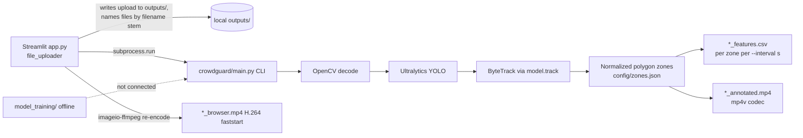
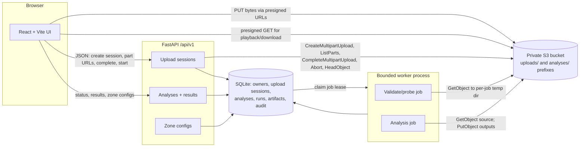
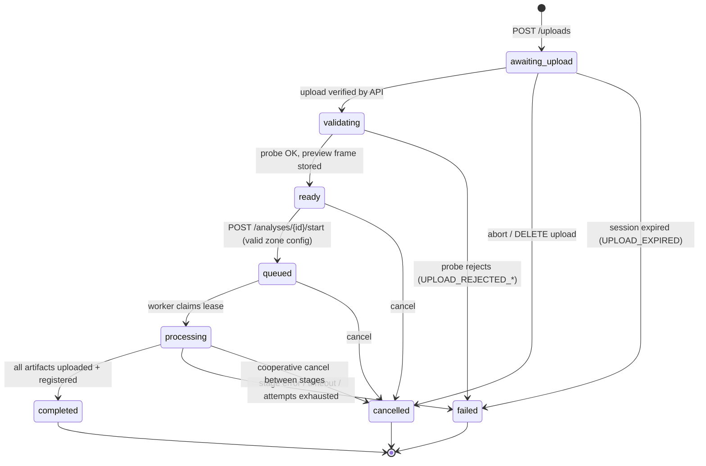
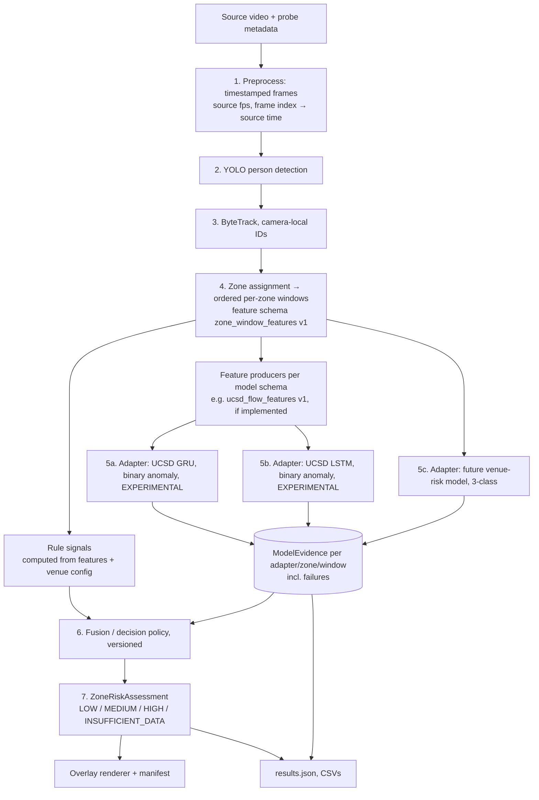

# CrowdGuard AI system architecture

**Status:** Architecture proposal, revision 2 (2026-11-26). Sections are tagged:

- **[Current]**: verified in the repository on 2026-11-26.
- **[Proposed]**: target design for the single-video MVP. Nothing tagged this way is implemented yet.
- **[Deferred]**: later phases that need separate approval.

The two supplied architecture images are reference concepts, not requirements. They show multi-camera input, RTSP, alerts, and a GRU/LSTM "Low/Medium/High" classifier. None of those exist, and several are deferred or blocked by validation (see [risk-assessment.md](risk-assessment.md)).

Related documents:

- [Monorepo structure](repository-structure.md): directory layout, package import names, dependency rules.
- [S3 direct-upload design](s3-upload.md): upload protocol, verification, S3 security.
- [Risk and model boundary](risk-assessment.md): labels, model-evidence contract, fusion policy, unknown states, validation, and the **open decisions register (D-01 to D-19, §11)**.
- [Implementation plan](../superpowers/plans/2026-11-26-crowdguard-product-architecture.md)
- [E2E acceptance cases](../testing/e2e-test-cases.md)

---

## 1. Product outcome

An operator uploads one authorized venue video in a website, selects or edits zones on a preview frame, and starts the analysis. CrowdGuard returns:

1. per-zone, time-ordered feature windows and a risk assessment for each window;
2. a playable video whose zone and risk overlays match those windows exactly;
3. downloadable results (JSON and CSV) with timestamps, model evidence, data-quality state, and the model and policy versions.

The MVP handles one video from one camera per analysis, as batch processing. Live streams, multi-camera fusion, alerts, and evacuation planning are deferred (§11).

---

## 2. Current state [Current]



| Area | Verified behavior | Gap relative to the product goal |
|---|---|---|
| UI | `app.py`: Streamlit upload, runs the pipeline with `subprocess.run`, re-encodes the output for the browser with `imageio_ffmpeg`. It states that validated risk prediction is not implemented. | Output names come from the uploaded filename stem, so two uploads with the same name collide. No job state, no isolation. `imageio_ffmpeg` is imported but not listed in `requirements.txt`. |
| Pipeline | `crowdguard/main.py`: argparse CLI with OpenCV, YOLO, ByteTrack (`tracker="bytetrack.yaml"`), point-in-polygon zone assignment, 8-way direction, a virtual-line crossing count, CSV aggregation every `--interval` seconds (default 1.0), and an annotated MP4 (`mp4v`). | Everything is in `main()`; there is no callable service, no progress callback, and no risk layer. |
| Features | CSV columns: `timestamp_start_s, timestamp_end_s, zone, people_count_avg, people_count_end, image_density_proxy_per_10000_px, mean_speed_px_per_s, dominant_direction, virtual_line_crossings_total, flow_crossings_per_s_interval, configured_capacity, occupancy_ratio, elapsed_video_s`. | Density is an image-area proxy and speed is in pixels per second. The flow line is one illustrative line, not per-zone flow. |
| Zones | `config/zones.json`: four illustrative normalized polygons with demonstration capacities and one illustrative flow line. | No config version, owner, or calibration. The capacities are placeholders, not venue data. |
| Training | `model_training/`: GRU and LSTM, binary `Normal`/`Anomalous` on UCSD Ped1/Ped2. The input is 10 frame-level optical-flow features (`CORE_FEATURE_COLUMNS`), sequence length 20, every 5th frame. | The label space is anomaly, not venue risk. The feature schema does not match the pipeline CSV. `outputs/metrics/recommendation.txt` says "Recommend LSTM for deployment" but also states the model is not validated; treat it as a comparison of experiments, not a deployment approval. |
| Inference | `model_training/src/inference.py` `ExperimentalPredictor.predict` returns `status: "experimental"`, `model_id: crowdguard_{gru,lstm}_v1`, class probabilities, and a data-quality dict. | It fills NaN with 0 and **runs inference even when the quality check fails**. It never checks sequence length. It warns and continues without the scaler. It loads checkpoints with `torch.load(weights_only=False)`, which is unsafe for untrusted files. The model ID is hard-coded rather than derived from the artifact. |
| API, DB, S3, React | None. | Everything in §3 onward is proposed. |

The Streamlit UI and the CLI stay in place until a separately reviewed migration replaces them (plan Phase 1 keeps the CLI as a thin adapter).

---

## 3. Target MVP architecture [Proposed]



### 3.1 Components

| Component | Proposed location | Responsibility | Must not |
|---|---|---|---|
| Web UI | `apps/web/` | Upload (single or multipart, retry, resume, abort), zone selection on a preview frame, start, status polling, synchronized video and zone table, downloads, limitation notices. | Hold AWS credentials, see S3 keys or the real multipart UploadId, or call the pipeline directly. |
| API | `apps/api/crowdguard_api/` | Validate requests, own upload sessions and object keys, verify completion with S3, create jobs, serve results and presigned download URLs after ownership checks. | Proxy video bytes, run inference, or accept filesystem or object paths from clients. |
| Shared contracts | `packages/contracts/crowdguard_contracts/` | Pydantic models, enums, error catalog shared by core, API, and worker. A generated TS client lives in `packages/api-client/`. | Import anything heavier than pydantic. |
| Repository layer | `packages/platform/crowdguard_platform/repositories/` | SQLite access behind interfaces (`AnalysisRepository`, `UploadSessionRepository`, `ArtifactRepository`, `AuditRepository`). | Leak SQL types into services. A later PostgreSQL implementation must swap in behind the same interfaces. |
| Object store | `packages/platform/crowdguard_platform/storage/` | `ObjectStore` interface (presign, multipart, list parts, head, get to file, put from file, delete prefix). There is an S3 implementation, and tests use an S3-compatible endpoint. | Build keys from client input. |
| Worker | `apps/worker/crowdguard_worker/` | Claim leased jobs, download to a per-job temp dir, probe, run the processing service, model adapters, fusion, and renderer, upload outputs, register artifacts, clean up. | Run inside the API event loop or without concurrency and time limits. |
| Processing service | `crowdguard/processing.py` (new; the CLI becomes an adapter) | Decode, YOLO, ByteTrack, zones, ordered per-zone feature windows, progress callbacks. | Know about HTTP, S3, or the database. |
| Model orchestration | `crowdguard/models/` (adapters, registry) | Run each registered, eligible adapter on its declared feature schema. Record `ModelEvidence` for every adapter, including failures. | Average or vote across adapters. |
| Fusion and policy | `crowdguard/risk/` | Combine eligible evidence and rule signals under a versioned policy into a `ZoneRiskAssessment`. | Invent thresholds, or coerce missing evidence to `LOW`. |
| Overlay renderer | `crowdguard/overlay.py` | Draw zones and the assessment for the window that contains each frame, and emit an overlay manifest. | Compute risk itself. It only renders the assessments it is given. |

Directory names follow [repository-structure.md](repository-structure.md). The API never imports the `crowdguard` core (no torch or OpenCV in the API process); only the worker does.

---

## 4. Upload flow summary [Proposed]

Video bytes go directly from the browser to a private S3 bucket. FastAPI controls the session, authorization, object key, completion, and job creation. The full protocol and S3 controls are in [s3-upload.md](s3-upload.md).

```mermaid
sequenceDiagram
    autonumber
    participant B as Browser
    participant A as FastAPI
    participant D as SQLite
    participant S as S3 (private)
    participant W as Worker
    B->>A: POST /uploads {display_name, size, content_type}
    A->>D: create analysis(awaiting_upload) + upload_session
    alt size >= multipart threshold
      A->>S: CreateMultipartUpload(generated key, checksum algo)
    end
    A-->>B: {upload_id, analysis_id, strategy, part_size, concurrency}
    loop each part (≤3 concurrent, retry failed parts)
      B->>A: POST /uploads/{id}/part-urls {part_number, size, checksum}
      A-->>B: short-lived presigned UploadPart URL
      B->>S: PUT part bytes (+checksum header)
      S-->>B: ETag
    end
    B->>A: POST /uploads/{id}/complete {parts[]} + Idempotency-Key
    A->>S: ListParts (authoritative), compare and validate
    A->>S: CompleteMultipartUpload(server part list)
    A->>S: HeadObject (size, checksum)
    A->>D: session uploaded; analysis validating; enqueue validate job
    W->>S: GetObject → per-job temp
    W->>W: probe container/codec/duration/fps, extract preview frame
    W->>D: analysis ready (or failed: UPLOAD_REJECTED_*)
    B->>A: POST /analyses/{id}/start {zone_config_id}
    A->>D: analysis queued
```

Only an object that passed S3 verification **and** the media probe can reach `ready`, and only a `ready` analysis can be started and enter the processing queue.

---

## 5. Job lifecycle [Proposed]

### 5.1 Analysis state machine



Upload-session states (`created → uploading → completing → uploaded | aborted | expired | failed`) are tracked separately in [s3-upload.md](s3-upload.md#5-upload-session-state-machine).

### 5.2 Worker rules

- **Queue:** a SQLite `jobs` table (`job_type ∈ {validate_upload, analyze}`). A worker claims a job with an atomic conditional `UPDATE` that sets `lease_owner` and `lease_expires_at`, and renews it with a heartbeat. An expired lease returns the job to the queue until `max_attempts` is reached, then the job fails with `WORKER_LEASE_EXPIRED`. Use WAL mode. Start with **one** worker process and a bounded queue length.
- **Runs:** each processing attempt gets a new `run_id`. Outputs go to `analyses/{analysis_id}/runs/{run_id}/`. Only a fully registered run is linked to the analysis as its result, so a failed or retried attempt can never expose partial or previous outputs.
- **Stages and progress:** `download → probe → decode/detect/track → features → model_adapters → fusion → render → encode → upload_outputs → register`. Progress and the current stage are persisted. The worker checks for cancellation between stages and every N frames.
- **Limits:** a per-stage timeout, a whole-job timeout, a maximum temp-disk size, and a maximum duration and resolution (from config). Exceeding a limit fails the job with a stable error code.
- **Failure:** delete the job's temp dir, delete the `runs/{run_id}/` prefix, set `failed` with a safe `error_code` (the traceback goes only to server logs), and leave other analyses and earlier runs untouched.
- **Idempotency:** every state transition is a compare-and-set on the expected previous state. Repeating `start`, `cancel`, or `complete` returns the current state and does not duplicate work.

---

## 6. Model orchestration and fusion [Proposed]

CrowdGuard orchestrates several Python components and fuses their evidence. It is not one model. Every model keeps its own raw evidence visible. Contract details are in [risk-assessment.md §4–§6](risk-assessment.md#4-model-adapter-contract).



Key rules (normative text is in the risk document):

1. Each adapter declares its model ID and version, artifact hash, label space, ordered class labels, feature schema ID, version, and ordered columns, sequence length, sampling step, and validation and calibration status.
2. The orchestrator gives an adapter only windows built for that adapter's declared schema. A mismatch produces `inference_status = SCHEMA_MISMATCH`, never a silent reorder or fill.
3. The fusion policy consumes only evidence whose label space and calibration it explicitly accepts. The UCSD GRU/LSTM label space (`ucsd_binary_anomaly`) is **never** mapped to Low/Medium/High. It appears in results as experimental anomaly evidence.
4. There is no averaging or majority vote unless the adapters share a validated label space and calibration. Prefer a separately trained and calibrated fusion model, or an explicitly versioned decision policy.
5. Missing, invalid, or ineligible evidence, missing venue thresholds, or an unavailable policy yields `INSUFFICIENT_DATA` with reason codes, never `LOW`.

**Consequence for the MVP:** no validated severity model and no approved venue thresholds exist, so real uploads will normally return `INSUFFICIENT_DATA` with reasons `NO_ELIGIBLE_SEVERITY_EVIDENCE` or `POLICY_THRESHOLDS_UNCONFIGURED`. Tests drive `LOW`, `MEDIUM`, and `HIGH` with a deterministic fake adapter and a fixture policy marked `DEMONSTRATION`. This is intended: the product should show the unknown state honestly rather than imply a safety judgment.

---

## 7. Result contracts [Proposed]

All API timestamps are ISO 8601 UTC. Window times are seconds of **source-video time** (from probed fps and frame index), and job wall-clock times are stored separately. Every artifact for one run carries the same `analysis_id`, `run_id`, `feature_schema`, `policy` and model descriptors.

### 7.1 Analysis status (`GET /api/v1/analyses/{analysis_id}`)

```json
{
  "schema_version": "analysis_status.v1",
  "analysis_id": "an_01J…",
  "status": "processing",
  "stage": "model_adapters",
  "progress": 0.62,
  "created_at": "2026-11-26T10:00:00Z",
  "updated_at": "2026-11-26T10:03:12Z",
  "source": {"display_name": "event.mp4", "size_bytes": 734003200, "duration_s": 312.4, "fps": 25.0, "width": 1920, "height": 1080, "codec": "h264"},
  "zone_config": {"id": "zc_…", "version": 3, "sha256": "…"},
  "error": null
}
```

`display_name` is shown only after escaping. It is never used for storage. `error` is `{code, message}` with a stable code from the error catalog (plan Task 1).

### 7.2 Per-zone window result (one element of `results.json.windows[]`)

```json
{
  "analysis_id": "an_01J…",
  "run_id": "run_01J…",
  "camera_id": "cam-1",
  "zone_id": "ENTRY",
  "window": {"index": 41, "start_s": 41.0, "end_s": 42.0},
  "features": {
    "schema_id": "zone_window_features", "schema_version": "1.0.0",
    "values": {"people_count_avg": 17.4, "people_count_end": 18, "image_density_proxy_per_10000_px": 3.8,
               "mean_speed_px_per_s": 5.1, "dominant_direction": "N", "occupancy_ratio": null},
    "units": {"image_density_proxy_per_10000_px": "persons per 10k image px (proxy)", "mean_speed_px_per_s": "px/s (proxy)"}
  },
  "data_quality": {"state": "OK", "warnings": [], "frames_expected": 25, "frames_decoded": 25},
  "rule_signals": [{"signal_id": "occupancy_ratio_vs_capacity", "value": null, "status": "NOT_CONFIGURED"}],
  "model_evidence": [
    {"model_id": "ucsd-anomaly-lstm", "model_version": "sha256:ab12…", "label_space": "ucsd_binary_anomaly",
     "inference_status": "SKIPPED_INELIGIBLE", "probabilities": null, "validation_status": "EXPERIMENTAL",
     "reason": "NO_FEATURE_PRODUCER_FOR_SCHEMA ucsd_flow_features"}
  ],
  "assessment": {
    "level": "INSUFFICIENT_DATA",
    "assessment_status": "EXPERIMENTAL",
    "reason_codes": ["NO_ELIGIBLE_SEVERITY_EVIDENCE", "POLICY_THRESHOLDS_UNCONFIGURED"],
    "policy": {"id": "crowdguard-default", "version": "0.1.0"},
    "evidence_refs": ["ucsd-anomaly-lstm@sha256:ab12…"]
  }
}
```

`occupancy_ratio` is `null` (with a quality warning) when no capacity from a named source is configured. A demonstration capacity must not produce a real-looking ratio.

### 7.3 Artifacts per completed run

| Artifact | Content | Source of truth |
|---|---|---|
| `results.json` | Analysis and source metadata, zone config (with hash), feature schema, model descriptors, policy, `windows[]` as above | **Authoritative** |
| `features.csv` | One row per zone window: the window keys plus the feature columns in schema order | Derived from the same in-memory objects as `results.json` |
| `zone_risk.csv` | One row per zone window: keys, level, assessment status, reason codes, policy version, quality state, one column group per model (status, label space, probabilities) | Derived |
| `overlay_manifest.json` | For each frame range: the zone ID and window index drawn, level, palette token | Derived; used by UI and tests |
| `annotated.mp4` | H.264, yuv420p, `+faststart`; zone polygons, zone label, level or unknown, window `[start–end]`, an "EXPERIMENTAL" marker | Rendered from the manifest |
| `manifest.json` | List of artifacts with SHA-256, size, content type, schema versions | Integrity check |

The overlay at frame time `t` shows the assessment for the window that contains `t` (batch-review semantics; see decision D-07 in the risk document). The UI zone table, the overlay, and the CSV rows must refer to the same `(zone_id, window.index)`.

---

## 8. API surface [Proposed]

All routes are under `/api/v1`. Every route that takes `{analysis_id}` or `{upload_id}` checks ownership first and returns `404` for both missing and not-owned resources.

| Method and route | Purpose |
|---|---|
| `POST /uploads` | Create the analysis and upload session; returns strategy and limits ([s3-upload.md §4](s3-upload.md#4-api-contract)) |
| `GET /uploads/{upload_id}` | Session state plus the server-verified part list (`ListParts`) for resume |
| `POST /uploads/{upload_id}/part-urls` | Presigned URLs for specific parts, or the single PUT URL |
| `POST /uploads/{upload_id}/complete` | Verify and complete; idempotent |
| `DELETE /uploads/{upload_id}` | Abort the upload and cancel the analysis |
| `GET /analyses/{analysis_id}` | Status, stage, progress, error |
| `GET /analyses/{analysis_id}/preview-frame` | Presigned GET for the preview frame, used to draw or check zones |
| `POST /analyses/{analysis_id}/start` | `{zone_config_id}`; `ready → queued` |
| `POST /analyses/{analysis_id}/cancel` | Cooperative cancel |
| `GET /analyses/{analysis_id}/results` | `results.json` content (paginated by window if large) |
| `GET /analyses/{analysis_id}/artifacts/{name}` | `name` from a fixed enum; returns a short-lived presigned GET |
| `GET/POST /zone-configs`, `GET /zone-configs/{id}` | Versioned zone configs; validated polygons; capacity with a source and owner, or null |

Polling is the MVP status mechanism. WebSocket push is deferred.

---

## 9. Storage [Proposed]

| Data | Store | Key / location | Notes |
|---|---|---|---|
| Owners, sessions, analyses, jobs, runs, artifacts, zone configs, audit | SQLite (WAL) | `var/crowdguard.db` (git-ignored) | Repository interfaces keep a later PostgreSQL move possible. |
| Source video | S3 private | `uploads/{analysis_id}/source` | Generated key; client filename stored only as escaped display metadata. |
| Preview frame | S3 private | `analyses/{analysis_id}/preview.jpg` | Written by the validate job. |
| Run outputs | S3 private | `analyses/{analysis_id}/runs/{run_id}/{artifact}` | Only artifacts registered in the DB are served. |
| Worker temp | Local disk | `{temp_root}/{job_id}/` | Created per job, deleted on every exit path. |
| Model artifacts | Local, read-only, outside the repo | Configured path plus pinned SHA-256 | Load only allow-listed hashes. Never commit weights. |

Retention: delete source videos, outputs, and DB rows after configurable periods (values are an open decision, D-11). S3 lifecycle rules enforce the same periods, and a deletion endpoint or job removes a whole analysis on request.

---

## 10. Security, privacy, and reliability [Proposed]

- **Untrusted input:** filenames, MIME types, declared sizes, part data from the browser, video content, zone configs, and model files. Verify object size and checksum with S3, probe the actual media, and validate polygon geometry.
- **Deployment modes:** the MVP may run only on a trusted network with one configured operator principal. Every resource still has an `owner_id`, and ownership checks run from day one. **An internet-facing deployment is blocked** until authentication, per-user ownership, quotas, rate limits, and audit records are implemented and reviewed (plan Phase 4).
- **S3:** a private bucket with Block Public Access, TLS-only bucket policy, default encryption, least-privilege IAM per role (API signer versus worker), CORS limited to the app origin, and a lifecycle rule that aborts incomplete multipart uploads. Presigned URLs are short-lived bearer credentials: never log them, cache them, or put them in analytics. Details are in [s3-upload.md §7](s3-upload.md#7-s3-and-iam-controls).
- **Model loading:** load only allow-listed artifacts by SHA-256, and prefer `weights_only=True` or safetensors. A pickled scaler or checkpoint can execute code, so the current `weights_only=False` load must be replaced in the adapter (plan Phase 2).
- **Privacy:** person detection and temporary, camera-local track IDs only. No face recognition, re-identification, or identity inference. Audit access to footage and downloads.
- **Safety claims:** results are decision support for trained operators. The UI and artifacts must say when output is experimental or insufficient. Do not present any output as certified safety advice or as an instruction to the public.
- **Secrets:** environment or secret store only. No AWS credentials in the browser, repo, logs, or artifacts.

---

## 11. Deferred phases [Deferred]

### 11.1 Multi-camera and live

RTSP ingestion, camera health, multi-camera spatial fusion, and alerts. Fusion requires per-camera calibration to a venue coordinate system, synchronized timestamps with bounded clock skew, and an explicit overlap and deduplication policy. ByteTrack IDs are camera-local and are not cross-camera identities. Keep `camera_id` in every contract now so this extension does not break the schema.

### 11.2 Evacuation planning (future product phase)

Not part of the MVP. The architecture keeps a seam for it but builds nothing.

- **Seam kept now:** stable `zone_id`s per zone config, a `camera_id` in every result, machine-readable versioned `results.json`, an assessment status that separates validated from experimental output, and the `INSUFFICIENT_DATA` state. A future planner consumes these through an `EvacuationPlanner` interface that does not exist yet.
- **Future inputs:** a venue topology graph (zones, exits, paths, doors), path capacities and lengths, calibrated zone risks in venue coordinates, crowd-flow estimates, blocked or closed routes, accessibility constraints (step-free routes, assisted-evacuation needs), and the venue's approved emergency procedures.
- **Future output:** a ranked route or flow **recommendation** with assumptions, input versions, and uncertainty, with status `DRAFT_FOR_HUMAN_REVIEW`. A responsible human reviews and acts on it.
- **Validation before any use:** simulation against venue scenarios, expert review with venue safety staff, and a documented failure analysis.
- **Prohibited in this and the next phases:** autonomous evacuation instructions, public-facing alerts, signage or PA control, or any automated dispatch.
